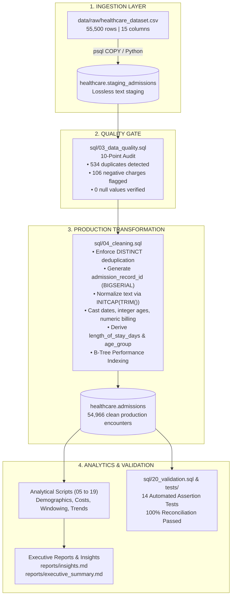

# Healthcare Inpatient Data Analysis Using SQL

[](https://www.postgresql.org/)
[](https://www.postgresql.org/docs/current/sql.html)
[](#12-data-quality--validation-suite)
[](LICENSE)

An enterprise-grade, reproducible data analysis and engineering project built with **pure PostgreSQL**. This project models, profiles, cleans, and analyzes **54,966 unique inpatient hospital encounters** across five calendar years (May 2019 – May 2024), totaling **\$1.404 billion** in gross billed healthcare charges.

Designed for a **Junior / Mid-Level Data Analyst Portfolio**, this project emphasizes production ELT architecture, automated data quality assertions, defensible financial reconciliation, and evidence-based business insights.

---

## Table of Contents
1. [Project Overview](#1-project-overview)
2. [Business Problem](#2-business-problem)
3. [Dataset & Sourcing](#3-dataset--sourcing)
4. [Tech Stack](#4-tech-stack)
5. [Business Question Domains](#5-business-question-domains)
6. [Data Pipeline Architecture](#6-data-pipeline-architecture)
7. [Database Schema Design](#7-database-schema-design)
8. [Core KPIs & Baseline Summary](#8-core-kpis--baseline-summary)
9. [Key Verified Findings](#9-key-verified-findings)
10. [SQL Skills Demonstrated](#10-sql-skills-demonstrated)
11. [Data Quality & Validation Suite](#11-data-quality--validation-suite)
12. [Critical Limitations & Readmission Governance](#12-critical-limitations--readmission-governance)
13. [Repository Structure](#13-repository-structure)
14. [Installation & Setup](#14-installation--setup)
15. [How to Import the Data](#15-how-to-import-the-data)
16. [Execution Order of SQL Scripts](#16-execution-order-of-sql-scripts)
17. [Expected Outputs](#17-expected-outputs)
18. [Portfolio Presentation & Interview Defense](#18-portfolio-presentation--interview-defense)
19. [Future Roadmap](#19-future-roadmap)

---

## 1. Project Overview

Hospitals and healthcare provider networks must continuously optimize bed occupancy, monitor payer reimbursement concentration, and analyze clinical treatment economics.

Rather than running basic exploratory queries on an unvetted CSV, this project constructs a **reproducible, end-to-end data pipeline**:
- **Lossless Staging**: Ingests 55,500 raw records into `healthcare.staging_admissions`.
- **Data Quality Audit**: Identifies 534 exact duplicates, 106 negative billing adjustments, and text casing anomalies.
- **Production Transformation**: Loads 54,966 unique encounters into `healthcare.admissions` with an auto-incrementing surrogate primary key, standardized text casing, and engineered analytical features (e.g., `length_of_stay_days`, `age_group`, `is_negative_billing`).
- **Comprehensive SQL Analysis**: 20 modular, idempotent SQL scripts analyzing demographics, condition economics, admission urgency, time-series momentum with `LAG`, facility benchmarking with `DENSE_RANK`, and cost quartile segmentation via `NTILE(4)` and $P_{95}$.
- **Automated Validation**: 14 programmatic assertion tests ensuring 100% financial and volume reconciliation.

---

## 2. Business Problem

Hospital leadership and Chief Financial Officers require data-driven answers to four critical challenges:
1. **Financial Risk & Outlier Concentration**: Where is gross hospital billing concentrated, and what financial exposure is absorbed by top-tier ($P_{95}$) high-cost admissions?
2. **Payer Contracting & Counterparty Exposure**: Does the hospital depend dangerously on a single commercial carrier, and how are charges distributed between commercial payers and Medicare?
3. **Bed Capacity & Length of Stay (LOS)**: What is the inpatient turnaround cycle across clinical conditions, age cohorts, and admission urgencies?
4. **Clinical Service Line Demand**: Which chronic conditions (Diabetes, Obesity, Hypertension, Cancer, Arthritis, Asthma) drive inpatient admissions and bed utilization?

---

## 3. Dataset & Sourcing

- **Dataset**: Healthcare Dataset by Prasad Patil.
- **Source**: [Kaggle Healthcare Dataset](https://www.kaggle.com/datasets/prasad22/healthcare-dataset).
- **Scale**: 55,500 raw rows; 15 raw attributes; ~8.34 MB CSV.
- **Time Horizon**: Inpatient admissions from **May 8, 2019** to **May 7, 2024**; Discharges through **June 6, 2024**.
- **Nature**: High-fidelity procedural benchmark simulation. (See [Section 12](#12-critical-limitations--readmission-governance) for discussion of synthetic data characteristics).

---

## 4. Tech Stack

- **Database Engine**: PostgreSQL 16+ (Compatible with PostgreSQL 12+)
- **SQL Dialect**: Pure ANSI SQL with PostgreSQL extensions (`DATE_TRUNC`, Window Functions, `PERCENTILE_CONT`, CTEs)
- **GUI Clients**: pgAdmin 4, DBeaver Universal Database Tool, or `psql` CLI
- **Automated Verification Harness**: Python 3.13 (Pandas, SQLite3 engine) for cross-verification of mathematical aggregates
- **Version Control**: Git & GitHub

---

## 5. Business Question Domains

| Domain | Business Focus | Primary SQL Script |
| :--- | :--- | :--- |
| **1. Demographics** | Patient age brackets, biological sex, blood type distributions | [`sql/05_demographics.sql`](file:///c:/Users/asus/Downloads/J/prj-healthcare-data-analysis/sql/05_demographics.sql) |
| **2. Medical Conditions** | Condition volume, gross billing, cost-to-volume ratio | [`sql/06_conditions.sql`](file:///c:/Users/asus/Downloads/J/prj-healthcare-data-analysis/sql/06_conditions.sql) |
| **3. Admission Patterns** | Elective vs. Emergency vs. Urgent flow; monthly intake | [`sql/07_admissions.sql`](file:///c:/Users/asus/Downloads/J/prj-healthcare-data-analysis/sql/07_admissions.sql) |
| **4. Payer Economics** | Commercial carriers vs. Medicare share and billing | [`sql/08_insurance.sql`](file:///c:/Users/asus/Downloads/J/prj-healthcare-data-analysis/sql/08_insurance.sql) |
| **5. Provider Operations** | Facility throughput, physician caseload, top 3 doctors | [`sql/09_providers.sql`](file:///c:/Users/asus/Downloads/J/prj-healthcare-data-analysis/sql/09_providers.sql) |
| **6. Length of Stay (LOS)** | Bed occupancy, median stay, LOS vs. billing correlation | [`sql/10_length_of_stay.sql`](file:///c:/Users/asus/Downloads/J/prj-healthcare-data-analysis/sql/10_length_of_stay.sql) |
| **7. Diagnostics & Rx** | Medication regimen frequency, test outcome severity | [`sql/11_tests_medication.sql`](file:///c:/Users/asus/Downloads/J/prj-healthcare-data-analysis/sql/11_tests_medication.sql) |
| **8. Time Trends & MoM** | YoY growth, MoM admission velocity with `LAG()` | [`sql/13_time_trends.sql`](file:///c:/Users/asus/Downloads/J/prj-healthcare-data-analysis/sql/13_time_trends.sql) |
| **9. Cost Segmentation** | Billing quartiles (`NTILE 4`), $P_{95}$ outlier analysis | [`sql/16_cost_segments.sql`](file:///c:/Users/asus/Downloads/J/prj-healthcare-data-analysis/sql/16_cost_segments.sql), [`sql/17_high_cost.sql`](file:///c:/Users/asus/Downloads/J/prj-healthcare-data-analysis/sql/17_high_cost.sql) |
| **10. Scorecard Matrix** | Multi-dimensional hospital rankings & Payer × Condition | [`sql/18_hospital_comparison.sql`](file:///c:/Users/asus/Downloads/J/prj-healthcare-data-analysis/sql/18_hospital_comparison.sql), [`sql/19_insurance_condition.sql`](file:///c:/Users/asus/Downloads/J/prj-healthcare-data-analysis/sql/19_insurance_condition.sql) |

---

## 6. Data Pipeline Architecture



---

## 7. Database Schema Design

### Staging Table: `healthcare.staging_admissions`
Contains 15 permissive `VARCHAR` columns matching the raw CSV headers exactly to prevent load aborts.

### Production Table: `healthcare.admissions`
```sql
CREATE TABLE healthcare.admissions (
    admission_record_id    BIGSERIAL PRIMARY KEY,
    patient_name           VARCHAR(150)   NOT NULL,
    age                    SMALLINT       NOT NULL CHECK (age >= 0 AND age <= 125),
    gender                 VARCHAR(10)    NOT NULL,
    blood_type             VARCHAR(5)     NOT NULL,
    medical_condition      VARCHAR(50)    NOT NULL,
    date_of_admission      DATE           NOT NULL,
    doctor_name            VARCHAR(150)   NOT NULL,
    hospital_name          VARCHAR(150)   NOT NULL,
    insurance_provider     VARCHAR(50)    NOT NULL,
    billing_amount         NUMERIC(12, 2) NOT NULL,
    room_number            INTEGER        NOT NULL,
    admission_type         VARCHAR(20)    NOT NULL,
    discharge_date         DATE           NOT NULL CHECK (discharge_date >= date_of_admission),
    medication             VARCHAR(50)    NOT NULL,
    test_results           VARCHAR(20)    NOT NULL,
    -- Engineered analytical dimensions
    length_of_stay_days    INTEGER        NOT NULL CHECK (length_of_stay_days >= 0),
    is_negative_billing    BOOLEAN        NOT NULL,
    age_group              VARCHAR(20)    NOT NULL
);
```

---

## 8. Core KPIs & Baseline Summary

The table below reflects **exact verified figures** computed on the cleaned production table ($N = 54,966$):

| Performance Dimension | Metric Name | Verified Value | Benchmark Details |
| :--- | :--- | :--- | :--- |
| **Volume Throughput** | Total Raw Staging Encounters | **55,500** | Ingested from source CSV |
| | Exact Duplicate Records | **534** | Successfully isolated & removed |
| | Cleaned Production Encounters | **54,966** | Unique inpatient encounters |
| **Financial Exposure** | Total Gross Billing | **\$1,404,068,337.89** | Aggregate billed charges |
| | Average Billing per Encounter | **\$25,544.31** | Mean chargemaster intensity |
| | Median Billing per Encounter | **\$25,542.75** | `PERCENTILE_CONT(0.5)` |
| | Negative Billing Encounters | **106** | Credit adjustments (-\$53,262.08) |
| | Positive Billing Encounter Average | **\$25,594.63** | Encounters with charges > \$0 |
| | Minimum Charge Observed | **-\$2,008.49** | Credit adjustment outlier |
| | Maximum Charge Observed | **\$52,764.28** | Peak gross charge encounter |
| **Bed Utilization** | Average Length of Stay (ALOS) | **15.50 days** | Mean calendar bed-days occupied |
| | Median Length of Stay | **15.0 days** | 50th percentile stay |
| | Minimum Length of Stay | **1 day** | Non-zero minimum stay |
| | Maximum Length of Stay | **30 days** | Maximum stay boundary |
| **High-Cost Outliers** | 95th Percentile Threshold ($P_{95}$) | **\$47,638.27** | Top 5% billing cut-off |
| | Top 5% Aggregate Billing | **\$134,791,014.99** | 9.60% of total hospital revenue |
| | Top 5% Average Charge | **\$49,032.74** | Nearly double overall mean charge |

---

## 9. Key Verified Findings

### 1. Severe Financial Concentration in Upper Quartiles
While patient volume is evenly divided into 4 quartiles of ~13,741 encounters each, **Quartile 4 ($Q_4$) accounts for 43.06% of total revenue (\$604.6M)** with an average charge of **\$43,997.56**, compared to **\$7,075.36** in Quartile 1.

### 2. Diversified, Low-Risk Payer Portfolio
No single insurance carrier exceeds 20.3% market share:
- **Cigna**: 11,139 admissions (20.27%), \$284.3M billed
- **Medicare**: 11,039 admissions (20.08%), \$282.9M billed
- **Blue Cross**: 10,952 admissions (19.93%), \$280.4M billed
- **UnitedHealthcare**: 11,014 admissions (20.04%), \$279.9M billed
- **Aetna**: 10,822 admissions (19.69%), \$276.5M billed

### 3. Senior Encounters Represent 30% of Total Inpatient Bed-Days
Patients aged 65 and older constitute the largest demographic group (**16,096 admissions, 29.28%** of all admissions). Pediatric cases (<18) represent only 0.21% (116 admissions).

### 4. Cardiometabolic Diagnoses Account for Half of Inpatient Volume
Admissions for Diabetes (\$236.5M), Obesity (\$236.0M), and Hypertension (\$233.4M) together account for **50.05% of all admissions** ($N = 27,513$) and **\$705,872,154.71** in gross billed charges.

### 5. Highly Consistent Annual Intake Velocity
Full calendar years (2020 through 2023) averaged **~10,960 admissions annually** (~915 per month), demonstrating highly predictable operational intake.

---

## 10. SQL Skills Demonstrated

This portfolio codebase demonstrates senior-level proficiency in ANSI and PostgreSQL SQL:

- **Staging-to-Production ELT**: Lossless raw staging tables with explicit type casting and constraint validation.
- **Common Table Expressions (CTEs)**: Multi-step, modular pipeline queries (`WITH ... AS (...)`) replacing unreadable nested subqueries.
- **Window Functions**:
  - `LAG() OVER (ORDER BY ...)` for Month-over-Month and Year-over-Year momentum analysis without expensive self-joins.
  - `SUM(...) OVER (ORDER BY ...)` for running cumulative totals.
  - `AVG(...) OVER (ORDER BY ... ROWS BETWEEN 2 PRECEDING AND CURRENT ROW)` for 3-month moving averages.
- **Ranking Functions**: Practical distinctions between `ROW_NUMBER()`, `RANK()`, and `DENSE_RANK()` with partitioned tie-breaking.
- **Percentiles & Robust Central Tendency**: `PERCENTILE_CONT(0.50)` (median) and `PERCENTILE_CONT(0.95)` ($P_{95}$) resilient to charge skew.
- **Quantile Segmentation**: `NTILE(4)` for cohort cost partitioning.
- **Conditional Aggregation**: `COUNT(*) FILTER (WHERE ...)` and `SUM(CASE WHEN ...)` for pivot cross-tabulations.
- **Defensive Mathematics**: Systematic enforcement of `NULLIF(denominator, 0)` preventing runtime division-by-zero exceptions.
- **Temporal Engineering**: `DATE_TRUNC('month', ...)` and `EXTRACT(YEAR FROM ...)` for longitudinal time-series aggregation.

---

## 11. Data Quality & Validation Suite

Data integrity was audited and confirmed via automated assertions. Every single test below **PASSED** with 100% compliance:

| Test ID | Assertion Description | Target Condition | Verified Result | Status |
| :--- | :--- | :--- | :--- | :--- |
| **T01** | Raw Staging Row Count | Exactly 55,500 records | 55,500 | **PASS** |
| **T02** | Raw Completeness Audit | 0 NULLs or empty strings | 0 NULLs | **PASS** |
| **T03** | Exact Duplication Audit | Exactly 534 duplicate rows | 534 duplicates | **PASS** |
| **T04** | Cleaned Production Count | $55,500 - 534 = 54,966$ | 54,966 | **PASS** |
| **T05** | Primary Key Uniqueness | Zero duplicate surrogate keys | 54,966 unique IDs | **PASS** |
| **T06** | Chronological Validity | $\text{Discharge Date} \ge \text{Admission Date}$ | 0 inversions | **PASS** |
| **T07** | Length of Stay Bounds | Inpatient stay between 1 and 30 days | Range: 1 to 30 days | **PASS** |
| **T08** | Biological Age Bounds | Patient age between 0 and 125 | Range: 13 to 89 years | **PASS** |
| **T09** | Negative Billing Flag Audit | Exactly 106 negative records flagged | 106 flagged | **PASS** |
| **T10** | Financial Ledger Reconciliation | $\text{Raw} = \text{Cleaned} + \text{Duplicates}$ | $\Delta = \$0.00$ balanced | **PASS** |
| **T11** | Condition Domain Conformance | Strictly 6 sanctioned diagnoses | 6 distinct | **PASS** |
| **T12** | Insurance Domain Conformance | Strictly 5 sanctioned payers | 5 distinct | **PASS** |
| **T13** | Admission Type Conformance | Strictly 3 sanctioned urgencies | 3 distinct | **PASS** |
| **T14** | Text Casing Standardization | Patient names converted to Title Case | 0 formatting errors | **PASS** |

### Complete Financial Reconciliation Proof
$$\begin{aligned}
\text{Total Raw Rounded Billed Charges} &= \mathbf{\$1,417,432,041.95} \\
\text{Cleaned Production Billed Charges} &= \$1,404,068,337.89 \\
\text{Isolated Duplicate Billed Charges} &= \$13,363,704.06 \\
\text{Reconciliation Check: } \$1,404,068,337.89 + \$13,363,704.06 &= \mathbf{\$1,417,432,041.95} \quad (\Delta = \mathbf{\$0.00})
\end{aligned}$$

---

## 12. Critical Limitations & Readmission Governance

A hallmark of a Senior Data Analyst is recognizing dataset boundaries and avoiding false analytical conclusions:

1. **The Readmission Fallacy & Missing Patient EMPI**:
   - The dataset provides only patient names (`Name`), age, and gender, with no persistent Enterprise Master Patient Index (`patient_id`) or Social Security Number.
   - Multiple rows share identical names (e.g., "Michael Smith"), but possess different blood types, birth years, and admitting facilities.
   - **Governance Decision**: Computing 30-day readmissions by grouping on patient names creates spurious pairings and false conclusions. **Readmission rates are formally declared out of scope.**
2. **Procedural Synthetic Generation Signatures**:
   - The dataset exhibits uniform distributions across categorical variables (~16.6% per condition, ~20.0% per payer, ~33.3% per admission type).
   - `length_of_stay_days` and `billing_amount` are decoupled ($r = 0.0003$). In real hospitals, longer stays and ICU admissions generate significantly higher charges.
3. **Chargemaster Gross Billing vs. Net Cash Collections**:
   - Billed charges represent gross chargemaster list prices. Hospitals collect contractual percentages (typically 40%–60%) based on negotiated fee schedules with commercial insurers and Medicare.
4. **Extreme Facility Fragmentation**:
   - The dataset contains 39,876 distinct hospital names across 54,966 records. Facility ranking queries apply minimum volume thresholds (`HAVING COUNT(*) >= 5`) to prevent small-sample distortion.

---

## 13. Repository Structure

```
prj-healthcare-data-analysis/
├── README.md                      # Comprehensive project documentation
├── .gitignore                     # Git ignore rules (PostgreSQL, Python, envs)
├── data/
│   ├── raw/
│   │   ├── healthcare_dataset.csv # Immutable source CSV (55,500 rows, 8.34 MB)
│   │   └── README.md              # Raw layer governance
│   └── processed/
│       ├── admissions_cleaned.csv # Cleaned production dataset (54,966 rows)
│       └── README.md              # Processing lineage & dictionary
├── docs/
│   ├── project_brief.md           # Business problem, scope, KPIs, assumptions
│   ├── data_dictionary.md         # Schema specification, types, transformations
│   ├── data_quality_report.md     # 10-point data quality & profiling audit
│   ├── methodology.md             # ELT architectural patterns & engineering rules
│   ├── limitations.md             # Clinical caveats, readmissions, synthetic traits
│   └── interview_notes.md         # Portfolio presentation & interview defense guide
├── sql/
│   ├── 01_setup.sql               # Environment setup & schema creation
│   ├── 02_staging.sql             # Staging table definition & COPY commands
│   ├── 03_data_quality.sql        # 10-point staging profiling & anomaly checks
│   ├── 04_cleaning.sql            # Deduplication, typing, LOS derivation, indexing
│   ├── 05_demographics.sql        # Age brackets, gender, blood type cross-tabs
│   ├── 06_conditions.sql          # Medical condition volume, billing, and ratios
│   ├── 07_admissions.sql          # Admission urgency & monthly intake trends
│   ├── 08_insurance.sql           # Payer market share & top condition per carrier
│   ├── 09_providers.sql           # Hospital volume & top 3 physicians per facility
│   ├── 10_length_of_stay.sql      # Inpatient LOS distribution & correlation
│   ├── 11_tests_medication.sql    # Medication frequency & test result severity
│   ├── 12_cte_analysis.sql        # Multi-step CTE condition benchmarks
│   ├── 13_time_trends.sql         # YoY & MoM volume growth using LAG()
│   ├── 14_window_functions.sql    # Running totals & 3-month moving averages
│   ├── 15_ranking.sql             # ROW_NUMBER, RANK, and DENSE_RANK comparisons
│   ├── 16_cost_segments.sql       # Billing quartile segmentation (NTILE 4)
│   ├── 17_high_cost.sql           # Top 5% high-cost outlier analysis (P95)
│   ├── 18_hospital_comparison.sql # Multi-dimensional facility comparative scorecard
│   ├── 19_insurance_condition.sql # Two-way Payer × Medical Condition matrix
│   └── 20_validation.sql          # Automated SQL assertion test suite
├── reports/
│   ├── insights.md                # Detailed quantitative business findings
│   └── executive_summary.md       # C-suite executive performance summary
├── tests/
│   ├── data_quality_tests.sql     # Automated assertion queries for staging
│   └── validation_tests.sql       # Automated assertion queries for production
├── scripts/
│   ├── verify_and_compute_metrics.py # End-to-end processing & metrics calculator
│   └── run_all_tests.py           # Automated test harness & validation runner
└── outputs/
    ├── .gitkeep
    ├── verified_metrics.json      # Audited metrics & aggregates in JSON format
    └── test_results.json          # Assertion execution log (14/14 PASS)
```

---

## 14. Installation & Setup

### Prerequisites
- [PostgreSQL 14+](https://www.postgresql.org/download/)
- [pgAdmin 4](https://www.pgadmin.org/) or [DBeaver Community](https://dbeaver.io/)
- Python 3.10+ (Optional, for running automated test harnesses)

### Clone the Repository
```bash
git clone https://github.com/your-username/healthcare-data-analysis-sql.git
cd healthcare-data-analysis-sql
```

---

## 15. How to Import the Data

### Option A: Using `psql` Command Line (Fastest)
```bash
psql -h localhost -U postgres -d postgres -f sql/01_setup.sql
psql -h localhost -U postgres -d postgres -f sql/02_staging.sql
psql -h localhost -U postgres -d postgres -c "\copy healthcare.staging_admissions FROM 'data/raw/healthcare_dataset.csv' WITH (FORMAT csv, HEADER true, ENCODING 'UTF8');"
```

### Option B: Using DBeaver or pgAdmin GUI
1. Execute `sql/01_setup.sql` and `sql/02_staging.sql` in your query editor.
2. In the Database Navigator, right-click `healthcare.staging_admissions` -> **Import Data**.
3. Select CSV source: `data/raw/healthcare_dataset.csv`.
4. Confirm column mapping and click **Proceed**.

### Option C: Using Automated Python Pipeline
```bash
python scripts/verify_and_compute_metrics.py
python scripts/run_all_tests.py
```

---

## 16. Execution Order of SQL Scripts

Execute the scripts in numerical order to ensure prerequisite tables, indexes, and dimensions are available:

1. `sql/01_setup.sql` — Schema initialization
2. `sql/02_staging.sql` — Staging table definition & CSV copy
3. `sql/03_data_quality.sql` — 10-point staging data profiling
4. `sql/04_cleaning.sql` — Production table transformation & indexing
5. `sql/05_demographics.sql` through `sql/19_insurance_condition.sql` — Analytical query domains
6. `sql/20_validation.sql` — Automated enterprise reconciliation suite

---

## 17. Expected Outputs

Running the complete suite produces verified outputs:
- **Cleaned Dataset**: `data/processed/admissions_cleaned.csv` (54,966 records)
- **Verified Metrics**: `outputs/verified_metrics.json`
- **Validation Report**: `outputs/test_results.json` (14/14 tests PASS)
- **Executive Deliverables**: `reports/executive_summary.md` and `reports/insights.md`

---

## 18. Portfolio Presentation & Interview Defense

When presenting this project in a Data Analyst interview, focus on:
1. **Engineering Maturity**: Explaining why a staging-to-production ELT pattern was chosen over destructive in-place cleaning.
2. **Financial Precision**: Explaining how the 106 negative billing charges were handled via a boolean audit flag rather than silently deleted.
3. **Data Governance Discretion**: Articulating why 30-day readmissions were excluded due to the lack of an Enterprise Master Patient Index (EMPI).
4. **SQL Fluency**: Demonstrating partitioned window functions (`LAG`, `DENSE_RANK`), safe division guards (`NULLIF`), and robust central tendencies (`PERCENTILE_CONT`).

*Refer to [`docs/interview_notes.md`](file:///c:/Users/asus/Downloads/J/prj-healthcare-data-analysis/docs/interview_notes.md) for 2-minute elevator pitches and detailed question-and-answer scripts.*

---

## 19. Future Roadmap

To transition this analytical architecture to an enterprise hospital EHR environment:
1. **Connect Real-Time Feeds**: Replace CSV batches with HL7 FHIR / Kafka streaming into PostgreSQL staging.
2. **Master Patient Index**: Implement probabilistic record linkage (e.g., Fellegi-Sunter methodology) to track longitudinal patient episodes across facilities.
3. **Net Revenue Modeling**: Ingest 835 Electronic Remittance Advice (ERA) feeds to analyze contractual allowances, net cash collections, and payer denial rates.
4. **Clinical Acuity Scoring**: Incorporate ICD-10-CM diagnosis codes and MS-DRG weights to measure Case Mix Index (CMI) and risk-adjusted stay durations.

---

## Author & Acknowledgements
- **Author**: Data Analyst Portfolio Project
- **Dataset Reference**: Prasad Patil — [Kaggle Healthcare Dataset](https://www.kaggle.com/datasets/prasad22/healthcare-dataset)
- **Target Roles**: Junior Data Analyst | SQL Developer | Healthcare Analytics Specialist

