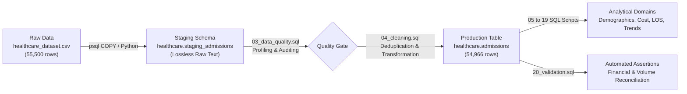

# Analytical Methodology & Engineering Pipeline

## 1. Architectural Philosophy: Staging-to-Production ELT

This project implements an industry-standard **Extract-Load-Transform (ELT)** architecture within PostgreSQL. Rather than mutating data in flight or performing ad-hoc cleaning in spreadsheets, the data pipeline maintains strict separation between raw ingestion and production analytics.

---

## 2. Ingestion & Staging Strategy

1. **Lossless Storage**: The staging table `healthcare.staging_admissions` defines every attribute as permissive text (`VARCHAR`). This guarantees that unexpected formatting, malformed dates, or extreme numerical values do not cause ingest failures.
2. **Audit Preservation**: Staging retains all 55,500 records exactly as provided in the Kaggle benchmark file. This allows reconciliations to trace any downstream record back to its raw origin.

---

## 3. Data Transformation & Cleaning Rules

The production table `healthcare.admissions` is constructed via `sql/04_cleaning.sql` following deterministic data transformation rules:

### A. Deduplication Protocol
- **Identification**: Records evaluated across all 15 raw source attributes simultaneously.
- **Action**: Applied `SELECT DISTINCT` across the 15 raw columns during insertion.
- **Result**: 534 duplicate records removed; 54,966 unique encounters loaded into production.

### B. Surrogate Key Generation
- Because the raw data lacks an enterprise master admission identifier, PostgreSQL generates an auto-incrementing surrogate primary key: `admission_record_id BIGSERIAL PRIMARY KEY`.
- This provides an immutable, high-performance join and aggregation anchor.

### C. Text Normalization
- Patient names normalized to proper Title Case via `INITCAP(TRIM(raw_name))`.
- String attributes (`doctor_name`, `hospital_name`, `medical_condition`, `insurance_provider`, etc.) stripped of leading/trailing whitespace.

### D. Controlled Type Casting
- `age`: Cast to `SMALLINT` with range verification check ($13 \le \text{age} \le 120$).
- `billing_amount`: Cast to `NUMERIC(12, 2)` to eliminate floating-point precision inaccuracies.
- `date_of_admission` & `discharge_date`: Cast to standard ISO-8601 `DATE`.
- `room_number`: Cast to `INTEGER`.

### E. Feature Engineering
- **`length_of_stay_days`**: Calculated as `(discharge_date - date_of_admission)`. Validated that all records yield $\ge 0$.
- **`is_negative_billing`**: Boolean flag set to `TRUE` if `billing_amount < 0`, isolating adjustments without dropping records.
- **`age_group`**: Engineered demographic dimension:
  - `< 18`: Pediatric / Minor
  - `18 - 35`: Young Adult
  - `36 - 50`: Adult
  - `51 - 65`: Middle-Aged
  - `65+`: Senior

---

## 4. Analytical Query Design Standards

To ensure production-grade SQL quality, all queries in `sql/` adhere to strict design guidelines:

1. **Explicit Column Selection**: Zero usage of `SELECT *` in final reporting queries. Every query explicitly states requested columns to optimize planner memory and maintain contract stability.
2. **Safe Division Safeguards**: All percentage calculations enforce `NULLIF(denominator, 0)` to guarantee mathematical immunity against zero-division errors.
3. **Robust Central Tendency**: Because healthcare charges frequently exhibit skew, analyses report both `AVG(billing_amount)` and `PERCENTILE_CONT(0.5) WITHIN GROUP (ORDER BY billing_amount)` (the exact median).
4. **Common Table Expressions (CTEs)**: Complex multi-step calculations use clear, modular `WITH` clauses rather than deeply nested unreadable subqueries.
5. **Window Functions & Analytics**: Time-series momentum (`LAG`), facility ranking (`DENSE_RANK()`), and cost tiering (`NTILE(4)`) are implemented natively in SQL without external processing.
6. **Explicit Schema Qualification**: All table references are explicitly schema-qualified as `healthcare.admissions`.

---

## 5. Financial Metric Interpretations

- **Gross Charges vs. Net Revenue**: `billing_amount` represents gross billed charges (hospital chargemaster pricing). In healthcare administration, gross charges do not represent cash collections, net revenue, or insurer reimbursement amounts.
- **Adjustments**: The 106 negative billing encounters are treated as accounting credit adjustments or billing corrections. Encounter-level cost benchmarking isolates positive records (`WHERE is_negative_billing = FALSE`), while ledger-level reconciliations include all rows.

---

## 6. Testing & Validation Protocols

Data integrity is guarded by automated assertions across three levels:

1. **Row Count Reconciliation**:
   $$\text{Staging Count} = \text{Cleaned Count} + \text{Duplicate Count}$$
   $$55,500 = 54,966 + 534 \quad \text{[BALANCED]}$$
2. **Financial Balance Reconciliation**:
   $$\text{Total Raw Rounded Billing} = \text{Total Cleaned Billing} + \text{Duplicate Billing}$$
   $$\$1,417,432,041.95 = \$1,404,068,337.89 + \$13,363,704.06 \quad \text{[BALANCED: } \Delta = \$0.00\text{]}$$
3. **Boundary & Logic Assertions**:
   - Zero negative lengths of stay.
   - Zero nulls across primary analytical keys.
   - 100% uniqueness of surrogate key `admission_record_id`.
