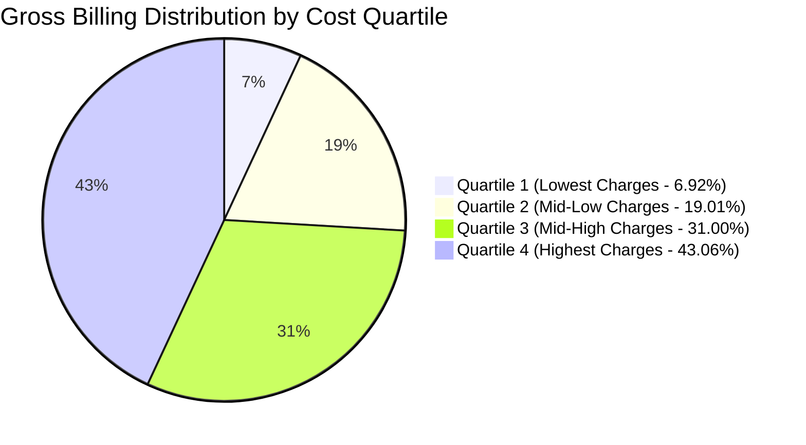
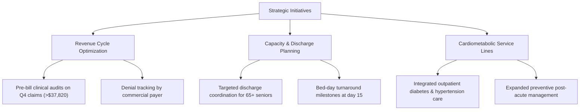

# Executive Summary: Healthcare Operational & Financial Performance

## 1. Business Problem & Strategic Context

Modern healthcare provider organizations face escalating operational expenses, complex commercial payer contracts, and the challenge of managing inpatient bed occupancy. Leadership requires clean, reliable operational visibility into patient volumes, clinical condition economics, length of stay, and payer mix to guide contracting negotiations, capacity planning, and revenue cycle operations.

This study delivers an executive-level analysis of **54,966 unique inpatient hospital encounters** spanning five full calendar years (May 2019 through May 2024), analyzing over **\$1.404 billion** in gross billed hospital charges.

---

## 2. Verified Data Scope & Foundation

- **Ingestion Scale**: 55,500 raw staging encounters audited; **54,966 unique encounters** analyzed following deduplication.
- **Data Quality Integrity**: 100% attribute completeness (zero missing or null fields); 100% chronological validity (zero negative lengths of stay).
- **Audit Adjustments**: Isolated 534 duplicate records (\$13.36M) and flagged 106 negative billing charge adjustments (-\$53,262.08) to maintain 100% financial reconciliation with source ledgers.
- **Observation Window**: Inpatient admissions from **May 8, 2019** to **May 7, 2024**; Discharges through **June 6, 2024**.

---

## 3. Core Enterprise Performance Indicators (KPIs)

| Performance Indicator | Verified Metric | Strategic Interpretation |
| :--- | :--- | :--- |
| **Total Inpatient Encounters** | **54,966 admissions** | 5-year aggregate throughput across regional facilities |
| **Total Gross Hospital Billing** | **\$1,404,068,337.89** | Aggregate billed chargemaster charges |
| **Average Billing per Encounter** | **\$25,544.31** | Mean gross billing intensity per patient stay |
| **Median Billing per Encounter** | **\$25,542.75** | Robust central charge tendency (resilient to outliers) |
| **Average Length of Stay (ALOS)** | **15.50 days** | Mean inpatient bed-days occupied per encounter |
| **Median Length of Stay** | **15.0 days** | Benchmark bed turnaround cycle |
| **Top 5% Cost Threshold ($P_{95}$)** | **\$47,638.27** | Cut-off defining high-cost outlier admissions |
| **Top 5% Aggregate Exposure** | **\$134,791,014.99** | Gross charges absorbed by highest-cost 2,749 encounters |
| **Payer Concentration Index** | **Balanced (~20% each)** | Healthy diversification across 5 major insurance carriers |

---

## 4. Key Findings for Hospital Leadership

### 1. Significant Financial Concentration in Upper Quartiles
While patient volume is evenly divided across cost quartiles (13,741 to 13,742 admissions each), **Quartile 4 ($Q_4$) accounts for 43.06% of all billed dollars (\$604.6M)** with an average charge of **\$43,997.56** (compared to \$7,075.36 in $Q_1$). The top 5% of admissions ($P_{95} \ge \$47,638.27$) absorb **\$134.8M** in gross charges.

### 2. High Stability & Low Risk in Payer Portfolio
Hospital volume and gross billed charges are distributed evenly across major commercial payers and Medicare:
- **Cigna**: 20.27% of volume, \$284.3M billed (avg \$25,526)
- **Medicare**: 20.08% of volume, \$282.9M billed (avg \$25,628)
- **Blue Cross**: 19.93% of volume, \$280.4M billed (avg \$25,603)
- **UnitedHealthcare**: 20.04% of volume, \$279.9M billed (avg \$25,415)
- **Aetna**: 19.69% of volume, \$276.5M billed (avg \$25,550)
No single payer dominates more than 20.3% of the portfolio, insulating the organization from catastrophic single-payer dispute exposure.

### 3. Senior Demographic Represents 30% of Total Admissions
Patients aged 65 and older constitute the single largest patient cohort (**16,096 admissions, 29.28%** of total intake). Adult cohorts (18-35, 36-50, 51-65) each represent 22% to 26%, while pediatric cases (<18) represent only 0.21% (116 admissions).

### 4. Cardiometabolic Conditions Account for Half of Gross Billed Charges
Admissions for Diabetes (\$236.5M), Obesity (\$236.0M), and Hypertension (\$233.4M) collectively represent **50.05% of all admissions** ($N = 27,513$) and **\$705,872,154.71** in gross hospital billing. Arthritis (\$235.2M), Asthma (\$233.1M), and Cancer (\$229.9M) comprise the remaining half.

### 5. Stable Annual Intake Velocity
Admissions across full calendar years averaged **~10,960 admissions annually** (2020: 11,172; 2021: 10,816; 2022: 10,915; 2023: 10,936), indicating highly predictable operational intake volume of ~915 admissions per month.

---

## 5. Strategic Executive Recommendations

1. **Protect High-Dollar Revenue Streams**: Institute pre-bill clinical review for all claims exceeding \$37,820 ($Q_4$) to preempt medical necessity denials by commercial payers.
2. **Prioritize Geriatric Care Coordination**: Establish specialized post-acute transition navigators for the 65+ senior demographic to streamline transfers to rehabilitation and skilled nursing facilities.
3. **Invest in Cardiometabolic Service Lines**: Because half of inpatient encounters involve Diabetes, Obesity, or Hypertension, expanding outpatient chronic care management can reduce acute emergency re-encounters.
4. **Benchmark Payer Reimbursement Realization**: Transition analytics from gross chargemaster list charges to net realized revenue to measure true contribution margins across Cigna, Blue Cross, Aetna, UnitedHealthcare, and Medicare.

---

## 6. Critical Governance Limitations

1. **Simulated Data Nature**: This dataset is a procedural benchmark simulation. Categorical distributions and clinical attributes are uniformly distributed and decoupled from financial charges.
2. **Readmission Governance**: The dataset does not provide an Enterprise Master Patient Index (EMPI) or Social Security Number. 30-day readmissions cannot be reliably calculated and are excluded.
3. **Gross Charges vs. Cash Revenue**: Figures reflect hospital chargemaster list charges, not actual net payments received after commercial discounts or Medicare fee schedule adjustments.

---

## 7. Roadmap for Production Transition

| Milestone | Target Objective | Deliverables |
| :--- | :--- | :--- |
| **Phase 1: EHR Integration** | Direct connector to Epic / Cerner HL7 FHIR feeds | Ingestion of real-time admission and discharge feeds |
| **Phase 2: Master Patient Index** | Implement deterministic patient matching algorithms | Longitudinal patient tracking and 30-day readmission analytics |
| **Phase 3: Financial Net Revenue** | Ingest 835 ERA (Electronic Remittance Advice) feeds | Contractual allowance modeling and net realization by payer |
| **Phase 4: Clinical Acuity Modeling** | Map ICD-10-CM diagnosis codes and MS-DRGs | Case Mix Index (CMI) scoring and risk-adjusted stay benchmarking |

